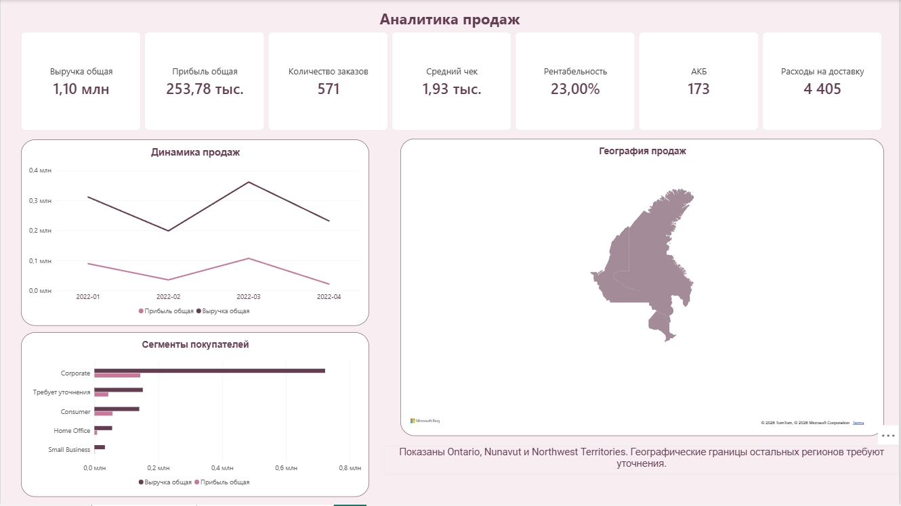
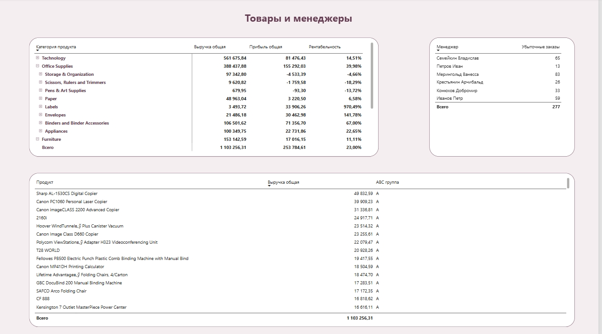

\# Анализ продаж в Power BI

Учебный проект по анализу продаж и логистических затрат.

\## Задача

Создать интерактивный отчёт для сравнения выручки и расходов на логистику за выбранный период.

\## Инструменты

Power BI Desktop.

\## Файл проекта

`анализ продаж.pbix` — отчёт для открытия в Power BI Desktop.

## Дашборды

### Страница 1

### Страница 2

